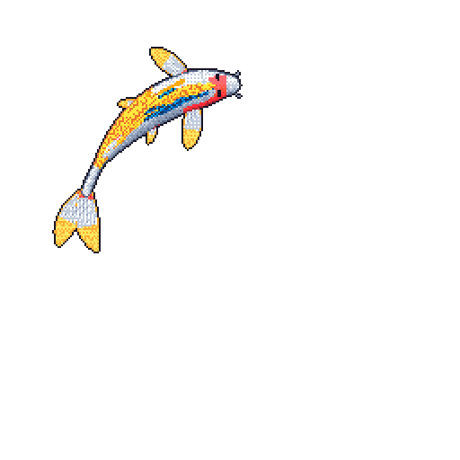
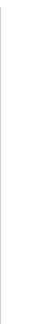
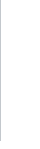

# Hello World

- Software Developer @ EI
- Builds full-stack web apps in React and native macOS apps in Swift
- Currently working on: macOS music activity app that lives on top of your screen - [RC v0.5.0]

##  Say Hi

- Email: [davidupdesign@gmail.com](mailto:davidupdesign@gmail.com)
- @davidupdesign: [X](https://x.com/davidupdesign) / [Linkedin](https://www.linkedin.com/in/davidupdesign/)

---

<h3>You are ＃</h3>
 
<a href="https://github.com/davidupdesign?tab=repositories"><picture><source media="(prefers-color-scheme: dark)" srcset="cards/languages-dark.svg"></picture></a> 

##  More on My Profile ↓